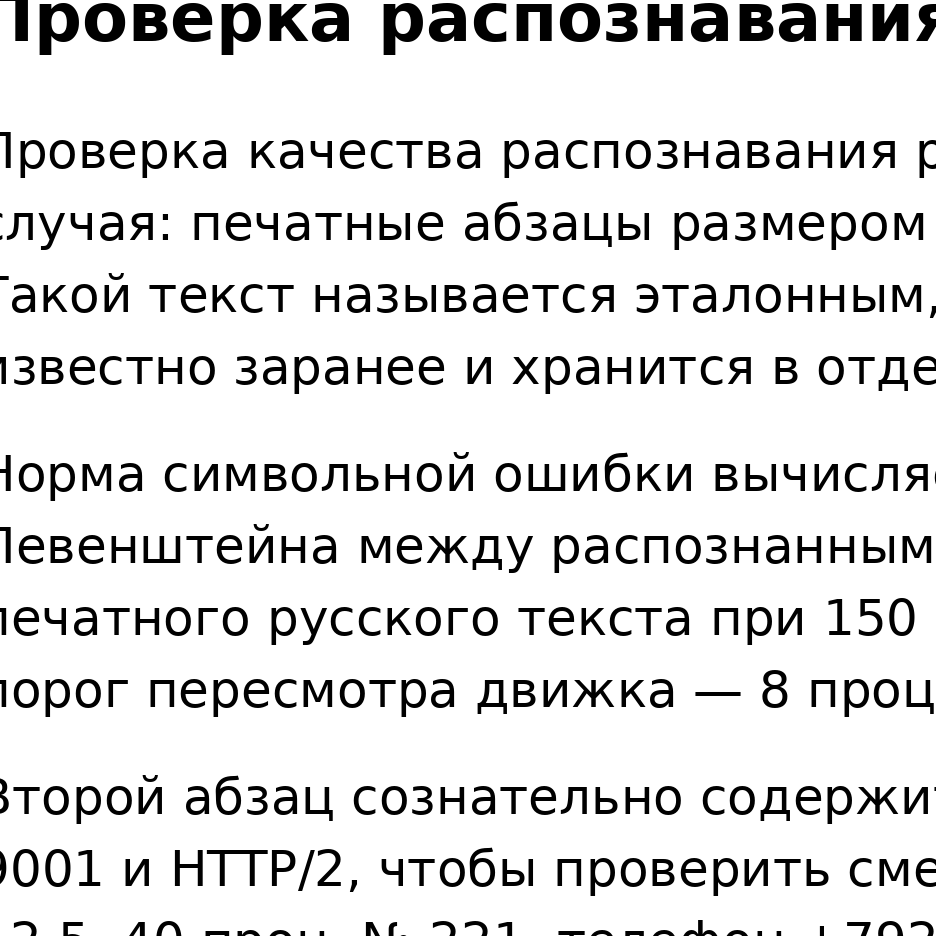

Проверка распознавания: эталонная страница 12pt
===============================================

| **Товар** | **Кол-во** | **Цена, руб** | **Сумма, руб** |
| --- | --- | --- | --- |
| Тетрадь 48 листов | 12 | 45,50 | 546,00 |
| Ручка синяя | 25 | 18,20 | 455,00 |
| Линейка 30 см | 8 | 32,00 | 256,00 |
| **Итого** | **45** |  | **1257,00** |

Проверка качества распознавания русского текста начинается с простого случая: печатные абзацы размером 12 пунктов на белом фоне при 300 dpi. Такой текст называется эталонным, потому что его точное содержание известно заранее и хранится в отдельном файле.

Норма символьной ошибки вычисляется как отношение расстояния Левенштейна между распознанным текстом и эталоном к длине эталона. Для печатного русского текста при 150 dpi цель составляет не более 3 процентов, а порог пересмотра движка — 8 процентов.

Второй абзац сознательно содержит латинские вставки, например GDP, ISO 9001 и НТТР/2, чтобы проверить смешанный текст. Числа тоже нужны: 1987, 12,5, 40 проц, № 221, телефон +79261234567 и индекс 119021.

Завершает страницу абзац с пунктуацией разных видов: кавычки-ёлочки «так», тире — и дефис-короткое словцо. Если модель теряет кавычки или путает тире с дефисом, Это попадает в отчёт как структурная потеря.

1. 1. первый пункт списка с номером один
2. 2. второй пункт со словом таблица
3. 3. третий пункт, он же последний

